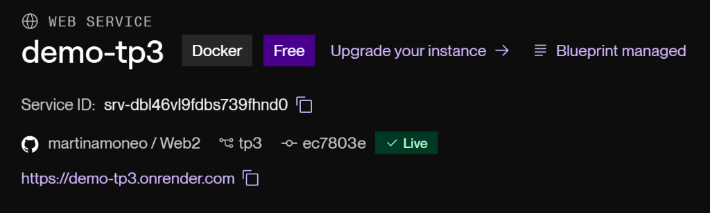
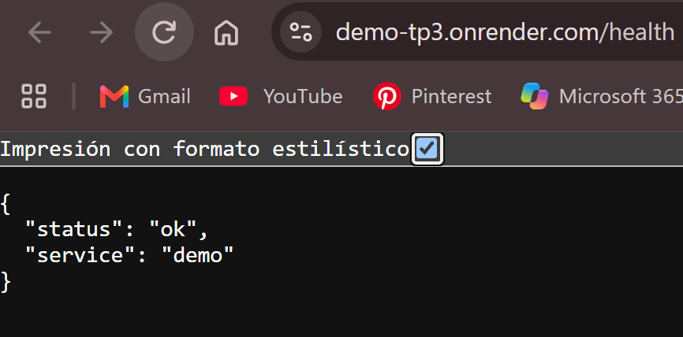

# TP3 · Autenticación, Autorización y Pruebas Automatizadas

Este proyecto amplía el TP2 incorporando autenticación stateless mediante JWT, autorización por rol y propiedad de recursos, pruebas unitarias y de integración con Testcontainers, y configuración externalizada mediante variables de entorno.

## Despliegue en Vivo (Render)

- **URL Base:** [https://demo-tp3.onrender.com](https://demo-tp3.onrender.com)
- **Endpoint de Salud (GET /health):** [https://demo-tp3.onrender.com/health](https://demo-tp3.onrender.com/health)
- **Documentación Interactiva (Swagger UI):** [https://demo-tp3.onrender.com/swagger-ui/index.html](https://demo-tp3.onrender.com/swagger-ui/index.html)

---

## Cómo levantar el proyecto localmente

**Requisitos:** Java 25 y Docker (recomendado).

### 1. Base de datos (Docker)

```bash
docker compose up -d
```
Levanta PostgreSQL en el puerto `5432` (base `webii_tp2`, usuario `webii_tp2`).

> *Si no usás Docker, creá la base y el rol manualmente en tu PostgreSQL local y ajustá los datos en `application.properties` o variables de entorno.*

### 2. Levantar la aplicación

```bash
# Windows
.\mvnw.cmd spring-boot:run

# macOS/Linux
./mvnw spring-boot:run
```
La aplicación estará disponible en `http://localhost:8080`.

---

## Cómo correr los tests

El proyecto distingue las pruebas según el sufijo de las clases y el plugin de Maven responsable de ejecutarlas:

### 1. Pruebas Unitarias (`*Test`)
Ejecutadas por **Maven Surefire Plugin** de forma rápida y aislada con mocks (Mockito), sin requerir servicios externos ni Docker:

```bash
# Windows
.\mvnw.cmd test

# macOS/Linux
./mvnw test
```

- **`ListaServiceImplTest`**:
  - `crear_usuarioAutenticado_asociaListaAUsuario`: verifica que la lista creada queda asociada al ID del usuario autenticado.
  - `obtener_listaAjena_lanzaAccesoDenegado`: verifica que un usuario con rol `USER` no puede acceder a una lista ajena (lanza `AccesoDenegadoException` / 403).
  - `obtener_adminAccedeListaAjena_devuelveLista`: verifica que un usuario con rol `ADMIN` sí puede acceder a listas ajenas.
  - `obtener_listaInexistente_lanzaRecursoNoEncontrado`: verifica el 404 al no encontrar la lista.
  - `eliminar_listaPropia_eliminaCorrectamente`: verifica la eliminación de una lista propia vacía.
- **`UsuarioServiceImplTest`**:
  - `registrar_contraseñaTextoPlano_nuncaGuardaEnTextoPlano`: verifica que la contraseña nunca se persiste en texto plano y que se hashea con el `PasswordEncoder`.
  - `registrar_emailExistente_lanzaEmailDuplicado`: valida el control de duplicados (409 Conflict).

### 2. Pruebas de Integración (`*IT`)
Ejecutadas por **Maven Failsafe Plugin** durante la fase `verify`. Utilizan **Testcontainers** para levantar un contenedor PostgreSQL real donde Flyway corre todas las migraciones (`V1` a `V6`) sobre una base limpia:

```bash
# Windows
.\mvnw.cmd verify

# macOS/Linux
./mvnw verify
```

- **`ListaControllerIT`**:
  - `login_credencialesValidas_devuelve200ConToken`: valida el login exitoso y emisión de token JWT (200).
  - `login_credencialesInvalidas_devuelve401`: valida rechazo por credenciales erróneas (401).
  - `listar_sinToken_devuelve401`: valida que endpoints protegidos exigen token (401).
  - `acceder_listaPropia_devuelve200`: valida acceso exitoso a recursos propios (200).
  - `acceder_listaAjena_devuelve403`: valida denegación a recursos ajenos sin rol admin (403).
  - `acceder_adminAccedeListaAjena_devuelve200`: valida que el rol `ADMIN` puede ver recursos de otros usuarios (200).

---

## Pipeline de Integración Continua (GitHub Actions)

El proyecto cuenta con un workflow de CI configurado en `.github/workflows/ci.yml` que se ejecuta en cada `push` y `pull_request`:

1. **Entorno:** Se ejecuta en una máquina virtual limpia `ubuntu-latest` con Java 25 (distribución Temurin) y caché de dependencias de Maven.
2. **Permisos:** Otorga permisos de ejecución a `mvnw` (`chmod +x mvnw`) para prevenir errores de `Permission denied`.
3. **Validación integral (`./mvnw verify`):**
   - Ejecuta las pruebas unitarias (`*Test`, con Maven Surefire).
   - Ejecuta las pruebas de integración (`*IT`, con Maven Failsafe), las cuales inicializan un contenedor PostgreSQL limpio mediante **Testcontainers** y corren todas las migraciones de **Flyway** de forma autónoma (sin depender de bases locales).
4. **Tolerancia a fallos:** El pipeline finaliza con error si algún test o migración falla, protegiendo la rama principal de regresiones.

---

## Consigna 7 · Despliegue en la Nube (Render)

El proyecto se encuentra desplegado y funcionando en [Render](https://render.com/) junto a una base de datos PostgreSQL remota.

- **Servicio Web:** `demo-tp3` (Plan Free, Runtime Docker)
- **Base de Datos:** `tp3-postgres` (PostgreSQL 16 en Render)
- **URL Pública:** `https://demo-tp3.onrender.com`

### Variables de Entorno Configuradas

| Variable de Entorno | Origen / Configuración en Render | Descripción |
|---|---|---|
| `SPRING_DATASOURCE_URL` | `fromDatabase: tp3-postgres (property: connectionString)` | URL de conexión al PostgreSQL remoto (procesada por `DatabaseUrlEnvironmentPostProcessor`) |
| `SPRING_DATASOURCE_USERNAME` | `fromDatabase: tp3-postgres (property: user)` | Usuario de la base de datos PostgreSQL |
| `SPRING_DATASOURCE_PASSWORD` | `fromDatabase: tp3-postgres (property: password)` | Contraseña del usuario de la base de datos |
| `JWT_SECRET` | `generateValue: true` | Clave secreta segura de 256 bits para firma HS256 |
| `JWT_EXPIRATION` | `86400000` | Expiración del token JWT (24 horas en milisegundos) |
| `PORT` | `8080` | Puerto HTTP expuesto por la aplicación |

### Verificación y Evidencias de Funcionamiento

#### 1. Panel de Render (Servicio en estado Live)


#### 2. Verificación del Endpoint de Salud (`GET /health`)
Petición HTTP pública directa al endpoint de salud desde el navegador:



```json
{
  "status": "ok",
  "service": "demo"
}
```

#### 3. Confirmación de Migraciones de Flyway en la Base Remota
En los logs de inicio del servicio en Render se confirma la aplicación secuencial de todas las versiones de migración sobre el esquema `public`:
```text
o.f.core.internal.command.DbMigrate      : Migrating schema "public" to version "1 - create favoritos"
o.f.core.internal.command.DbMigrate      : Migrating schema "public" to version "2 - create listas"
o.f.core.internal.command.DbMigrate      : Migrating schema "public" to version "3 - add lista id to favoritos"
o.f.core.internal.command.DbMigrate      : Migrating schema "public" to version "4 - backfill lista defecto"
o.f.core.internal.command.DbMigrate      : Migrating schema "public" to version "5 - create usuarios"
o.f.core.internal.command.DbMigrate      : Migrating schema "public" to version "6 - add usuario id a listas"
o.f.core.internal.command.DbMigrate      : Successfully applied 6 migrations to schema "public"
```

#### 4. Confirmación de Arranque sin Errores
Los logs del contenedor en Render demuestran el arranque limpio de Spring Boot:
```text
[DatabaseUrlEnvironmentPostProcessor] Successfully configured JDBC URL: jdbc:postgresql://dpg-...-a.oregon-postgres.render.com:5432/webii_tp3
...
Tomcat started on port 8080 (http) with context path '/'
Started DemoApplication in 5.341 seconds (process running for 6.12)
```

#### 5. Verificación de Autenticación y Base de Datos en Vivo
```bash
# 1. Registro de nuevo usuario (201 Created)
curl -X POST https://demo-tp3.onrender.com/api/auth/registro \
  -H "Content-Type: application/json" \
  -d '{"email":"alumno@example.com","password":"PasswordSeguro123"}'

# 2. Login y obtención de token JWT (200 OK con token)
curl -X POST https://demo-tp3.onrender.com/api/auth/login \
  -H "Content-Type: application/json" \
  -d '{"email":"alumno@example.com","password":"PasswordSeguro123"}'
```

---

## Endpoints de la API

| Método | Path | Auth requerida | Descripción |
|---|---|---|---|
| POST | `/api/auth/registro` | Pública | Registro de nuevos usuarios (rol `USER` por defecto) |
| POST | `/api/auth/login` | Pública | Autenticación y obtención de token JWT |
| GET | `/health` | Pública | Chequeo de salud básico (`{"status":"ok","service":"demo"}`) |
| GET | `/ping` | Pública | Devuelve `pong` (sin formato JSON) |
| GET | `/api/productos` | Pública | Catálogo de productos (consumido de DummyJSON) |
| GET | `/api/productos/{id}` | Pública | Detalle de un producto puntual |
| GET / POST | `/api/favoritos` | Bearer Token | Listar / crear favoritos |
| GET / PUT / DELETE | `/api/favoritos/{id}` | Bearer Token | Obtener, actualizar o eliminar un favorito |
| GET / POST | `/api/listas` | Bearer Token | Listar (solo propias o todas si ADMIN) / crear lista (asociada al usuario autenticado) |
| GET / PUT / DELETE | `/api/listas/{id}` | Bearer Token | Ver, editar o borrar lista (requiere ser dueño o ADMIN) |
| POST | `/api/listas/{origenId}/mover-favoritos` | Bearer Token | Mover favoritos entre listas propias |
| GET | `/api/listas/{id}/favoritos` | Bearer Token | Favoritos de una lista propia (o cualquiera si ADMIN) |

> **Documentación interactiva (Swagger UI en Render):** https://demo-tp3.onrender.com/swagger-ui/index.html  
> **Documentación interactiva (Swagger UI Local):** http://localhost:8080/swagger-ui/index.html

---

## Justificaciones del Trabajo Práctico

### Paso 3: Migración a JPA y Arquitectura Hexagonal
Al migrar la persistencia desde la memoria hacia PostgreSQL usando JPA, pudimos observar en la práctica los beneficios de la **Arquitectura Hexagonal**.

- **Qué se modificó (Infraestructura / Adapters):** Se crearon migraciones SQL, la entidad `FavoritoEntity`, el repositorio `FavoritoJpaRepository` y un **Adapter** (`FavoritoRepositoryAdapter`). Se eliminó `InMemoryFavoritoRepository`.
- **Qué NO se modificó (Core / Dominio / Controllers):** El controlador (`FavoritoController`), el servicio (`FavoritoService`), el modelo (`Favorito`) y la interfaz (`FavoritoRepository`) quedaron intactos.

**¿Por qué?** Porque el núcleo de la aplicación se aísla de la infraestructura. El servicio solo conoce el "puerto" (`FavoritoRepository`) y no le importa dónde se guardan los datos. Mientras el adaptador cumpla ese contrato, el cambio de base de datos es totalmente transparente.

### Paso 6: Evolución del Esquema (Migraciones)
Al alterar una tabla existente (ej. hacer `lista_id NOT NULL`), se debe crear una **nueva migración (ej. V4)** en lugar de modificar las anteriores. Flyway lleva un registro mediante checksums; si modificamos un archivo viejo, detectará la manipulación y abortará. Agregar migraciones garantiza una historia lineal, inmutable y predecible de la base de datos en todos los entornos.

### Paso 7: Uso de @Transactional (Propiedad ACID)
Al "mover favoritos de una lista a otra y luego borrar la lista original", realizamos múltiples escrituras (UPDATE a favoritos y DELETE a la lista). El uso de `@Transactional` garantiza la **Atomicidad** (la A de ACID): todas las operaciones se tratan como un bloque indivisible. Si ocurriera un error en el medio, se realiza un *rollback* completo, evitando que la base de datos quede en un estado inconsistente (como una lista vacía "zombie").

### TP3 - Autorización: Propiedad de recursos y control de acceso por rol

**¿Dónde vive la regla de autorización?**
La regla de validación de propiedad de recursos y rol (`USER` vs `ADMIN`) vive en la capa de servicios (`ListaServiceImpl`), es decir, en la lógica de negocio de la aplicación.

**¿Por qué se eligió implementarla en el Service y no en el Controller?**
1. **Lógica de dominio vs. transporte (Arquitectura Hexagonal):** Determinar a quién pertenece una lista y si la operación está permitida según el rol del usuario autenticado es una regla de negocio intrínseca. El Controller es un adaptador primario cuya única responsabilidad es transformar pedidos HTTP y delegar en el servicio.
2. **Reutilización y consistencia:** Si el día de mañana se agrega otro punto de entrada (por ejemplo, mensajes por cola, eventos, GraphQL, gRPC o comandos de consola), las reglas de autorización seguirán plenamente garantizadas en el Service sin duplicar código ni depender de la capa web.
3. **Semántica de errores clara (404 vs 403):** El servicio busca primero la entidad (`buscarOFallar`). Si la lista no existe, lanza `RecursoNoEncontradoException` (404 Not Found). Si existe pero pertenece a otro usuario y quien consulta no es `ADMIN`, lanza `AccesoDenegadoException` (403 Forbidden). De esta manera se evita filtrar información o confundir un recurso inexistente con uno prohibido.
4. **Testabilidad:** Permite verificar la regla de autorización en pruebas unitarias aisladas con mocks, sin la sobrecarga de levantar la infraestructura web ni filtros HTTP.
